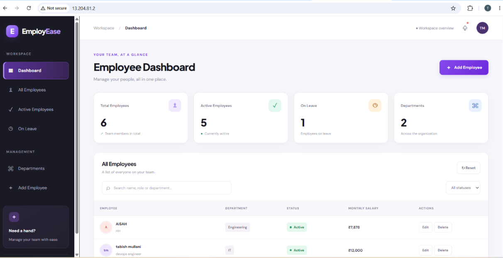
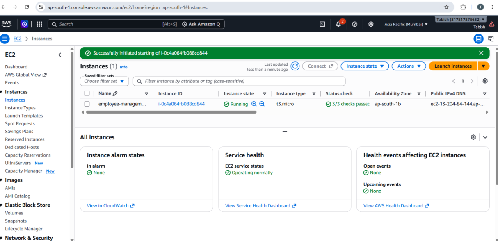
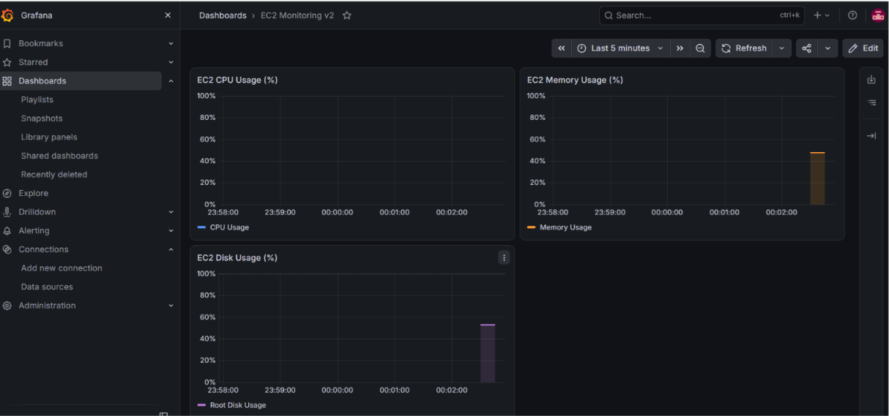

# Employee Management System | Cloud & DevOps Project

## About the Project

The Employee Management System is a full-stack web application built using React.js, Node.js, Express.js, and PostgreSQL. I developed this project to practise application development and learn how to deploy, automate, and monitor a web application using Cloud and DevOps tools.

The project includes Docker-based containerization, a Jenkins CI/CD workflow, AWS EC2 deployment, Terraform infrastructure configuration, and Prometheus/Grafana monitoring.

## Features

- Add, view, update, and delete employee records.
- Search and filter employee data.
- REST API integration with PostgreSQL.
- Docker containerization.
- Jenkins CI/CD workflow integrated with GitHub.
- AWS EC2 deployment on Ubuntu Linux.
- Infrastructure configuration using Terraform.
- Server CPU, memory, and disk monitoring using Prometheus and Grafana.

## Technology Stack

| Category | Technologies |
|---|---|
| Frontend | React.js, Vite, JavaScript, CSS |
| Backend | Node.js, Express.js |
| Database | PostgreSQL |
| Version Control | Git, GitHub |
| Containerization | Docker, Docker Compose |
| CI/CD | Jenkins |
| Cloud Platform | AWS EC2 |
| Infrastructure as Code | Terraform |
| Monitoring | Prometheus, Node Exporter, Grafana |
| Server Environment | Ubuntu Linux, Nginx |

## Architecture

### Application Architecture

```text
             User / Browser
                    |
                    v
             React Frontend
                    |
                 REST API
                    |
                    v
           Node.js + Express
                    |
                    v
             PostgreSQL DB
```

### DevOps Workflow

```text
GitHub → Jenkins → Docker → AWS EC2
                              |
                              v
                     Deployed Application
                              |
                              v
                  Node Exporter → Prometheus
                                      |
                                      v
                                    Grafana
```

## Project Structure

```text
employee-management-3tier/
├── frontend/
├── backend/
├── database/
├── employee-monitoring/
│   ├── docker-compose.yml
│   ├── prometheus/
│   │   └── prometheus.yml
│   ├── grafana/
│   │   └── ec2-monitoring.json
│   └── README.md
├── terraform/
│   ├── main.tf
│   ├── variables.tf
│   ├── terraform.tfvars.example
│   └── .terraform.lock.hcl
├── .gitignore
└── README.md
```

## Run Locally

### Prerequisites

Install Node.js, npm, PostgreSQL, and Git.

Clone the repository:

```bash
git clone https://github.com/tabish-devops/employee-management-3tier.git
cd employee-management-3tier
```

### Database Setup

Create a PostgreSQL database named `employee_db` and execute `database/schema.sql`.

### Backend

```bash
cd backend
npm install
```

Configure the required local database settings in a `.env` file according to the backend configuration. Keep credentials private.

Start the backend using its configured start command.

### Frontend

Open another terminal:

```bash
cd frontend
npm install
npm run dev
```

Open the local URL displayed by Vite, usually `http://localhost:5173`.

## Docker and Jenkins CI/CD

Docker is used to containerize application services. Jenkins is used to practise automating the build and deployment workflow, with GitHub as the source-code repository.

Depending on the pipeline configuration, the workflow can include source checkout, Docker image builds, and deployment to AWS EC2.

## AWS and Terraform

The application has been deployed on AWS EC2 running Ubuntu Linux.

The Terraform configuration defines an EC2 instance, its security group, and related outputs. SSH access is restricted through a configurable CIDR variable, while HTTP access is configured for the website.

Review Terraform plans before applying infrastructure changes, as AWS resources may incur charges.

## Monitoring with Prometheus and Grafana

Prometheus and Grafana run locally using Docker Compose. Node Exporter exposes operating-system metrics from the EC2 instance through an SSH tunnel.

The Grafana dashboard displays:

- **CPU Usage:** Processor utilization.
- **Memory Usage:** RAM utilization.
- **Disk Usage:** Root filesystem utilization.

Start the monitoring services from the monitoring directory:

```bash
docker compose up -d
```

Access the dashboards:

- Prometheus: `http://localhost:9090`
- Grafana: `http://localhost:3000`

Live EC2 metrics require the instance to be running and the SSH tunnel to be connected. Node Exporter port `9100` should not be exposed publicly.

## Project Screenshots

### Employee Management Website


### Jenkins CI/CD Pipeline


### AWS EC2 Deployment


### Grafana Monitoring Dashboard


## What I Learned

- Full-stack application development and CRUD operations.
- REST API and PostgreSQL integration.
- Git and GitHub version control.
- Docker containerization and Jenkins CI/CD concepts.
- AWS EC2 deployment and Linux server administration.
- Terraform infrastructure as code.
- Prometheus metrics collection and Grafana visualization.

## Author

**Tabish Mullani**

GitHub: [tabish-devops](https://github.com/tabish-devops)

Repository: [Employee Management System – 3-Tier](https://github.com/tabish-devops/employee-management-3tier)

This project is part of my Cloud Computing and DevOps learning portfolio.
